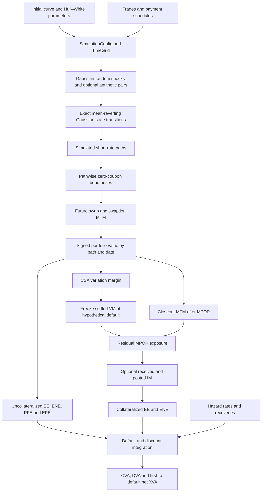

# Monte Carlo exposure simulation and XVA: quantitative implementation

> **Scope:** This chapter follows the PyCCR source implementation.
> It distinguishes uncollateralized exposure, collateralized closeout
> exposure and credit integration. All formulas should be interpreted
> under the specific assumptions documented below.

## 1. End-to-end architecture

**Key implementation modules**

| Operation | Source |
|---|---|
| Simulation grid and settings | `src/pyccr/simulation/time_grid.py`, `config.py` |
| Hull–White paths | `src/pyccr/simulation/hull_white_paths.py` |
| Correlated HW/FX paths | `src/pyccr/simulation/joint_fx_hw_paths.py` |
| Swap path valuation | `src/pyccr/pricing/hull_white_swap_exposure.py` |
| Swaption path valuation | `src/pyccr/pricing/hull_white_swaption_exposure.py` |
| IR portfolio valuation | `src/pyccr/pricing/hull_white_ir_portfolio.py` |
| Uncollateralized exposure | `src/pyccr/exposure/profiles.py` |
| CSA, VM, MPOR, IM | `src/pyccr/collateral/` |
| Collateral exposure composition | `src/pyccr/exposure/collateral_profiles.py` |
| Credit and XVA | `src/pyccr/credit/`, `src/pyccr/xva/` |
| End-to-end collateral example | `examples/collateral_xva_end_to_end.py` |

## 2. Define the portfolio and valuation conventions

The simulation produces **signed future portfolio MTM** in one
consistent currency, arranged as

\[
V\in\mathbb R^{N_{\mathrm{paths}}\times N_{\mathrm{times}}}.
\]

Positive values represent a claim against the counterparty; negative
values represent an obligation. The caller is responsible for
aggregating trades within legally enforceable netting sets before
applying the positive/negative part.

The Hull–White swap valuation code assumes single-curve discounting
and floating-rate projection, no payment lag or historical fixings,
and no cash-flow accumulation. Values at payment dates exclude
cash flows settled at that date.

**Interview point:** Exposure is not simply today's MTM grown forward.
It is a distribution of *future replacement values*, conditional on
the simulated market state and the remaining contractual cash flows.

## 3. Construct the simulation grid

`TimeGrid` requires \(t_0=0\) and strictly increasing year fractions.
`TimeGrid.uniform` creates a regular grid. `SimulationConfig` stores
path count, seed, and the optional antithetic flag.

For swap and swaption path revaluation, the supplied grid must contain
the required reset, expiry, and payment dates exactly. This prevents
silent interpolation across contractual events.

The model curve must extend through the simulation and trade horizon.

## 4. Generate random shocks

Without external shocks, the Hull–White simulator uses NumPy's
`default_rng(seed)` and standard normal draws with shape

\[
(N_{\mathrm{paths}},N_{\mathrm{steps}}).
\]

When `antithetic=True`, the path count must be even. Half the normal
draws are generated and the other half are their negatives.

Externally supplied normal draws are also supported, permitting
shared innovations with other factors.

**Interview point:** Antithetic sampling changes the Monte Carlo
estimator's variance, not the model's stochastic dynamics. Its
effectiveness should be measured rather than assumed.

## 5. Simulate the Hull–White state exactly

For the curve-consistent model

\[
r_t=x_t+\phi(t),\qquad
dx_t=-ax_tdt+\sigma dW_t^{\mathbb Q},
\]

PyCCR computes the deterministic shift

\[
\phi(t)=f(0,t)+
\frac{\sigma^2}{2a^2}(1-e^{-at})^2.
\]

On a time interval \(\Delta t_i\), the implemented exact transition is

\[
x_{i+1}=e^{-a\Delta t_i}x_i+
\sigma\sqrt{
\frac{1-e^{-2a\Delta t_i}}{2a}
}\,Z_i,
\qquad Z_i\sim N(0,1).
\]

Then \(r_{i+1}=x_{i+1}+\phi(t_{i+1})\).

This is an **exact Gaussian transition for the OU state at grid
points**, rather than Euler–Maruyama. It avoids Euler discretization
bias in the marginal OU transition; it does not eliminate time-grid
error in exposure observation, cash-flow handling or XVA integration.

The output is a matrix of shape
`(n_paths, n_steps + 1)`.

## 6. Reconstruct future term structures

For every path \(p\), observation time \(t_i\), and remaining
cash-flow maturity \(T\), the pricing engine evaluates

\[
P^{(p)}(t_i,T)
=A(t_i,T)\exp[-B(t_i,T)r^{(p)}(t_i)].
\]

The functions \(A\) and \(B\) come from the same
`HullWhiteCurveModel` used in calibration and simulation.

The future curve is therefore determined by the simulated short-rate
state and the initial term structure, rather than by independently
simulating every maturity point.

## 7. Revalue swaps path by path

`value_hull_white_swap_paths` values the remaining fixed and floating
legs for every path and date.

At the beginning \(T_{j-1}\) of a floating accrual period, the code
sets the pathwise floating coupon amount per unit notional to

\[
L_j^{(p)}\delta_j
=\frac{1}{P^{(p)}(T_{j-1},T_j)}-1.
\]

Before reset, the relevant forward amount is determined from the
current simulated discount curve; after reset, the already-fixed
pathwise amount is used. Remaining coupons are discounted using
\(P^{(p)}(t,T_j)\).

Past payments are excluded. The result is a matrix of signed swap
values for all simulated paths and observation dates.

**Why this matters:** Correct treatment of fixing dates prevents
future information from entering the value of a coupon that has
already reset.

## 8. Revalue physically settled swaptions

`value_hull_white_swaption_paths` treats three valuation regimes:

1. **Before expiry:** conditional Jamshidian decomposition is evaluated
   using the simulated discount bonds at the observation date and the
   remaining time to expiry. The option is not exercised early.
2. **At expiry:** the underlying payer or receiver swap is valued on
   each path. Exercise occurs exactly once when that signed swap value
   is strictly positive.
3. **After expiry:** exercised paths retain the signed MTM of the
   underlying swap; unexercised paths remain at zero. The exercise
   decision is not reconsidered at subsequent dates.

The grid must contain the swaption expiry and all underlying payment
dates. Already settled cash flows are excluded.

The implementation uses the expiry-time exercise decision without
looking ahead to later simulated swap values. This distinction is
essential when constructing future swaption exposure profiles.

## 9. Aggregate trades and compute exposure

`value_hull_white_ir_portfolio` combines supported interest-rate trade
valuations into pathwise portfolio MTM. Legal netting-set selection
remains the caller's responsibility.

For a netted portfolio value \(V^{(p)}(t_i)\):

\[
E_+^{(p)}(t_i)=\max(V^{(p)}(t_i),0),
\]

\[
E_-^{(p)}(t_i)=\max(-V^{(p)}(t_i),0).
\]

`calculate_exposure_profiles` computes

\[
EE(t_i)=\frac1N\sum_p E_+^{(p)}(t_i),
\qquad
ENE(t_i)=\frac1N\sum_p E_-^{(p)}(t_i).
\]

Potential future exposure is the cross-sectional quantile

\[
PFE_q(t_i)=Q_q(E_+^{(p)}(t_i)).
\]

PyCCR uses NumPy's **linear quantile interpolation**. The default
confidence level is \(q=0.95\).

The implemented scalar EPE is the time average of EE using
trapezoidal integration:

\[
EPE=\frac{1}{t_m-t_0}
\sum_{i=1}^{m}
\frac{EE(t_{i-1})+EE(t_i)}2
(t_i-t_{i-1}).
\]

This is not automatically the regulatory **effective EPE** measure.
The uncollateralized exposure profile does not itself apply
discounting, credit default or collateral.

## 10. Apply CSA variation margin

The CSA module represents bilateral thresholds and margin-call
conventions. With positive portfolio value meaning an amount owed
by the counterparty, the VM target in the inspected code has the
form

\[
VM_{\mathrm{target}}(V)
=\max(V-H_C,0)-\max(-V-H_O,0),
\]

where \(H_C\) and \(H_O\) are counterparty and own thresholds.

`simulate_variation_margin` tracks collateral calls, settled
transfers, pending transfers, and the effective settled VM balance.
A positive VM balance represents collateral held; a negative balance
represents collateral posted.

The simulation follows these explicit conventions:

- Grid index zero is a scheduled margin-call date.
- Due settlements are applied before new margin calls at a grid point.
- A new call targets the difference between required VM and the sum
  of settled collateral plus outstanding scheduled transfers.
- Transfers below the minimum transfer amount are not scheduled.
- Zero-lag transfers settle immediately.
- Transfers whose settlement date falls beyond the simulation
  horizon remain pending and do not become effective collateral.

The VM target is therefore not necessarily the settled collateral
balance. This matters when calculating residual exposure and
freezing effective VM at a hypothetical default date.

The module does not independently model collateral interest,
haircuts, legal enforceability, or default.

## 11. Apply margin period of risk

`calculate_mpor_exposures` separates:

- **Default time** \(t_d\), when settled VM is frozen.
- **Closeout time** \(t_{d+k}\), after `mpor_steps=k`.

The closeout value is evaluated at the later date, but the available
VM is the balance frozen at the earlier default date.

In schematic form, the residual closeout value is

\[
R_d^{(p)}
=V^{(p)}(t_{d+k})-VM^{(p)}_{\mathrm{settled}}(t_d).
\]

Positive and negative closeout exposures are obtained from the
positive and negative parts of this residual.

The output has `n_times - mpor_steps` default-time observations.
No terminal extrapolation is performed to manufacture missing
closeout dates.

**Interview point:** Freezing collateral at default while market
risk continues through MPOR captures gap risk. Using collateral
from the closeout date instead would understate that mechanism.

## 12. Apply segregated bilateral initial margin

`calculate_initial_margin_exposures` handles **received IM** and
**posted IM** as separate nonnegative balances.

Received IM reduces positive counterparty-default exposure;
posted IM reduces negative own-default exposure. Both balances are
sampled at the hypothetical **default date**, not at the later
closeout date.

With \(R_d^{(p)}\) denoting the MPOR residual after frozen VM,
the implemented IM-adjusted exposures are

\[
E_{+,IM}^{(p)}(t_d)=
\max(R_d^{(p)}-IM_{\mathrm{received}}^{(p)}(t_d),0),
\]

\[
E_{-,IM}^{(p)}(t_d)=
\max(-R_d^{(p)}-IM_{\mathrm{posted}}^{(p)}(t_d),0).
\]

The received and posted IM arrays are validated separately.
The implementation does not net them into one signed IM balance.

This is an exposure adjustment, not a full simulation of
regulatory IM models, custody arrangements or funding costs.

`calculate_collateral_exposure_profiles` composes the existing
VM, MPOR and IM components without changing their individual
conventions.

## 13. Convert exposure into CVA and DVA

`ConstantHazardCurve` supplies flat-hazard default probabilities.
For constant counterparty hazard \(\lambda_C\),

\[
S_C(t)=e^{-\lambda_Ct},\qquad
\Delta PD_{C,i}=S_C(t_{i-1})-S_C(t_i).
\]

The unilateral CVA code uses **endpoint exposure and discounting**:

\[
CVA=(1-R_C)\sum_{i=1}^{m}
D(0,t_i)\,EE(t_i)\,\Delta PD_{C,i}.
\]

DVA uses the corresponding expected negative exposure magnitude,
own recovery and own default probabilities.

The formulas assume independence between exposure and default and
use supplied deterministic discount factors. They are not
wrong-way-risk Monte Carlo estimators.

## 14. First-to-default bilateral adjustment

`calculate_first_to_default_xva` models independent exponential
counterparty and own default times with constant hazards
\(\lambda_C,\lambda_O\).

For interval \([t_{i-1},t_i]\), let
\(\lambda_\Sigma=\lambda_C+\lambda_O\). The code computes

\[
p_{C,i}^{first}
=\frac{\lambda_C}{\lambda_\Sigma}
e^{-\lambda_\Sigma t_{i-1}}
(1-e^{-\lambda_\Sigma\Delta t_i}),
\]

\[
p_{O,i}^{first}
=\frac{\lambda_O}{\lambda_\Sigma}
e^{-\lambda_\Sigma t_{i-1}}
(1-e^{-\lambda_\Sigma\Delta t_i}).
\]

The zero-total-hazard case is handled separately.

Then

\[
CVA_{FTD}=(1-R_C)\sum_i
D(0,t_i)EE(t_i)p_{C,i}^{first},
\]

\[
DVA_{FTD}=(1-R_O)\sum_i
D(0,t_i)ENE(t_i)p_{O,i}^{first}.
\]

The signed net adjustment convention is

\[
XVA_{\mathrm{net}}=DVA_{FTD}-CVA_{FTD}.
\]

The first-to-default probabilities are integrated analytically
within each interval, while exposure and discount factors are
sampled at interval endpoints.

## 15. Critical default-time versus closeout-time alignment

For collateralized XVA, `calculate_collateral_xva` takes exposures
indexed by **hypothetical default dates**, even though the exposure
calculation uses portfolio closeout values after MPOR.

Consequently, the discount-factor vector supplied to this adapter
must match the **default-time grid**, not the later closeout-time grid.

The adapter computes and returns **separate results** for
unilateral CVA, unilateral DVA, bilateral XVA, and first-to-default
bilateral XVA. These outputs must not be added together as though
they were independent valuation adjustments.

For each result, the expected exposure profile is indexed by
hypothetical default time. The supplied deterministic discount
factors must have the same shape and timing as that default-time
grid, even though closeout MTM is evaluated later.

The adapter does not add a separate funding-cost model.

## 16. Correlated Hull–White and FX scenarios

`simulate_joint_fx_hull_white_paths` constructs a two-factor
correlation matrix and supplies shared correlated innovations to
the short-rate and FX simulators.

However, the FX process uses **constant domestic and foreign rates
in its drift**, rather than the simulated Hull–White short rate.
The code therefore models correlated shocks but does not yet
implement fully coupled stochastic-rate FX drift or joint calibration.

This distinction is essential when interpreting hybrid exposures.

## 17. Numerical validation checklist

A technical reviewer should verify:

- Reproducibility under fixed random seeds.
- Antithetic versus ordinary Monte Carlo estimator variance.
- OU transition mean and variance against analytical values.
- Initial-curve and bond-pricing consistency.
- Future swap cash-flow and reset-date conventions.
- Swaption exercise and post-expiry valuation.
- Correct portfolio/netting-set aggregation.
- EE, ENE, PFE and EPE against independent calculations.
- VM settlement, default-date freezing and MPOR gap exposure.
- Received/posted IM signs and closeout alignment.
- Zero-hazard and zero-exposure XVA limits.
- CVA/DVA sign conventions and first-to-default probabilities.
- Stability with respect to path count and exposure time grid.

## 18. Research scope and limitations

The audited implementation supports substantial quantitative
experimentation but should not be described as a production CCR
platform without additional controls and validation.

In particular, this workflow does not establish production market
data bootstrapping, multi-curve interest-rate modelling,
time-dependent Hull–White volatility, wrong-way risk, correlated
counterparty defaults, full stochastic-rate FX drift coupling,
regulatory capital calculations, or a jointly coupled collateral,
default and funding valuation framework.

PyCCR separately implements deterministic funding valuation adjustment
through `calculate_fva` and additive CVA/DVA/FVA reporting through
`calculate_combined_xva`. These functions are not integrated into the
collateral-aware `calculate_collateral_xva` adapter documented here.
A separate `calculate_collateral_fva` adapter in
`pyccr.xva.collateral_fva` computes funding adjustments from
pathwise portfolio values net of settled variation margin. It
derives expected positive and negative residual funding exposures
and delegates the deterministic funding calculation to
`calculate_fva`. The collateral-aware CVA/DVA adapter does not
automatically include FVA; the two calculations remain separate.
This funding calculation does not apply default-survival weighting
or stochastic funding costs, and does not model segregated initial
margin funding, collateral remuneration or rehypothecation.

The core exposure functions require the caller to respect netting,
currency consistency and the documented trade-date conventions.

See [Hull–White / LGM calibration](hull_white_calibration.md)
for the calibration process that can supply the simulation model.
