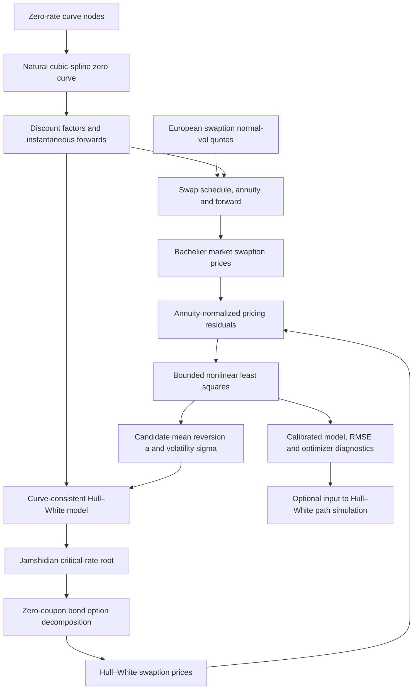

# Hull–White / LGM calibration: quantitative implementation

> **Scope:** This chapter documents the PyCCR one-factor, curve-consistent
> Hull–White calibration and pricing code at the audited commit. It describes
> implemented methods, rather than an assumed production calibration system.
> The example swaption data are illustrative; the model has constant
> mean reversion and constant volatility.

## 1. End-to-end calibration architecture

**Implementation map**

| Stage | Source |
|---|---|
| Curve interpolation | `src/pyccr/market/smooth_discount_curve.py` |
| Hull–White bond pricing and drift | `src/pyccr/models/hull_white_curve.py` |
| Bachelier pricing and implied volatility | `src/pyccr/pricing/bachelier_swaption.py` |
| Analytical bond options | `src/pyccr/pricing/hull_white_bond_option.py` |
| Jamshidian swaption pricing | `src/pyccr/pricing/hull_white_swaption.py` |
| Parameter optimization | `src/pyccr/calibration/hull_white_calibration.py` |
| Executable example | `examples/hull_white_normal_vol_calibration.py` |

## 2. Construct the initial term structure

`SmoothDiscountCurve` accepts strictly increasing maturities beginning at
zero and continuously compounded zero rates. It interpolates zero rates
with a **natural cubic spline**, with no extrapolation beyond the final node.

For interpolated zero rate \(z(0,T)\):

\[
P(0,T)=\exp[-Tz(0,T)].
\]

The instantaneous forward rate and its derivative are obtained from the
spline and its derivatives:

\[
f(0,T)=z(0,T)+T\partial_T z(0,T),
\]

\[
\partial_T f(0,T)
=2\partial_T z(0,T)+T\partial_{TT}z(0,T).
\]

These quantities enter both the model's deterministic drift and its
curve-consistent bond-pricing formula.

**Interview point:** Curve interpolation is not cosmetic. Differentiating
a curve to obtain instantaneous forwards and the Hull–White drift makes
the choice of interpolation and curve smoothness important. PyCCR uses
a smooth spline but does not perform a full market-instrument bootstrap
in this particular module.

## 3. Specify the one-factor model

The short-rate formulation is

\[
dr_t=[\theta(t)-ar_t]dt+\sigma\,dW_t^{\mathbb Q},
\]

with \(a>0\) and constant \(\sigma\geq0\). The deterministic drift
\(\theta(t)\) is fixed by the initial term structure:

\[
\theta(t)=\partial_t f(0,t)+af(0,t)
+\frac{\sigma^2}{2a}(1-e^{-2at}).
\]

PyCCR implements this in `HullWhiteCurveModel.theta`.

An equivalent shifted Gaussian-state representation is

\[
r_t=x_t+\phi(t),\qquad
dx_t=-ax_tdt+\sigma dW_t^{\mathbb Q},\quad x_0=0,
\]

where

\[
\phi(t)=f(0,t)+
\frac{\sigma^2}{2a^2}(1-e^{-at})^2.
\]

The latter representation is used by the path simulator. It is
closely related to the one-factor linear Gaussian Markov (LGM)
representation, but the audited calibration code specifically
implements the constant-parameter Hull–White form.

## 4. Reconstruct future zero-coupon bonds

For \(T\geq t\), PyCCR evaluates

\[
P(t,T)=A(t,T)e^{-B(t,T)r_t},
\]

\[
B(t,T)=\frac{1-e^{-a(T-t)}}{a},
\]

\[
A(t,T)=\frac{P(0,T)}{P(0,t)}
\exp\left[
B(t,T)f(0,t)
-\frac{\sigma^2(1-e^{-2at})B(t,T)^2}{4a}
\right].
\]

This is an affine bond-pricing formula: once the model parameters,
initial curve and simulated short rate are known, future discount bonds
can be evaluated analytically without nested Monte Carlo.

**Code:** `HullWhiteCurveModel.b_factor`,
`variance_adjustment`, `a_factor`, and `bond_price`.

## 5. Transform normal-volatility quotes into market prices

Each `SwaptionQuote` contains expiry, payment dates, normal volatility,
optional strike, and payer/receiver direction. When strike is omitted,
the code uses the forward par swap rate (ATM).

For expiry \(T_e\), fixed-leg payment dates \(T_i\), and accruals
\(\delta_i=T_i-T_{i-1}\), with \(T_0=T_e\):

\[
A_0=\sum_i\delta_iP(0,T_i),
\qquad
F_0=\frac{P(0,T_e)-P(0,T_n)}{A_0}.
\]

With normal volatility \(\nu_N\), define
\(s=\nu_N\sqrt{T_e}\), direction \(\eta=+1\) for a payer
and \(\eta=-1\) for a receiver, and
\(d=\eta(F_0-K)/s\).

The Bachelier market price per unit notional is

\[
V^{Bach}=A_0\left[
\eta(F_0-K)\Phi(d)+s\varphi(d)
\right].
\]

At zero total volatility, the code uses intrinsic value directly.
Normal volatility is expressed in **absolute rate units**, not in
basis-point numbers. The separate implied-volatility function uses
Brent root-finding to invert Bachelier prices; the calibration objective
itself compares **prices**, not implied-volatility differences.

**Code:** `bachelier_swaption_price`,
`implied_normal_volatility`, and `SwaptionQuote`.

## 6. Price model swaptions using Jamshidian decomposition

For a European swaption whose underlying swap begins at expiry,
define coupon-bond weights

\[
c_i=K\delta_i,\quad i<n,\qquad
c_n=1+K\delta_n.
\]

At expiry, the payer swap value per unit notional is

\[
V_{\mathrm{payer}}(T_e)
=1-\sum_i c_iP(T_e,T_i).
\]

The code finds a **critical short rate** \(r^*\) satisfying

\[
\sum_i c_iP(T_e,T_i;r^*)=1.
\]

Because Hull–White bond prices decrease with the short rate, this
coupon-bond value is monotone for the nonnegative coupon weights
accepted by the implementation. PyCCR expands an initial root bracket
and solves the equation using `scipy.optimize.brentq`, with
`xtol=1e-12`.

It then defines individual bond strikes

\[
K_i^*=P(T_e,T_i;r^*).
\]

Jamshidian's decomposition converts the payer swaption into a weighted
sum of **puts on zero-coupon bonds**, and the receiver swaption into a
weighted sum of **calls on zero-coupon bonds**:

\[
V^{HW}_{payer}=\sum_i c_i Put_i,\qquad
V^{HW}_{receiver}=\sum_i c_i Call_i.
\]

The analytical bond-option formula uses the effective lognormal
bond-forward volatility

\[
v_i=\sigma B(T_e,T_i)
\sqrt{\frac{1-e^{-2aT_e}}{2a}}.
\]

With \(F_i=P(0,T_i)/P(0,T_e)\),

\[
d_1=\frac{\ln(F_i/K_i^*)}{v_i}+\frac{v_i}{2},
\qquad d_2=d_1-v_i.
\]

For example, the call value is

\[
Call_i=P(0,T_i)\Phi(d_1)
-K_i^*P(0,T_e)\Phi(d_2).
\]

The code also handles the zero-volatility intrinsic-value limit.

**Why this matters:** Each candidate parameter pair is evaluated using
analytical bond options plus a one-dimensional root solve, not an inner
Monte Carlo simulation. This makes repeated calibration evaluations
computationally practical.

**Code:** `hull_white_swaption_price`,
`bond_option_volatility`, and `bond_option_price`.

## 7. Define and solve the calibration objective

For instrument \(j\), PyCCR computes

\[
\epsilon_j(a,\sigma)=
\frac{V_j^{HW}(a,\sigma)-V_j^{Bach}}{A_j}.
\]

The optimizer minimizes

\[
\min_{a,\sigma}\frac12\sum_{j=1}^M
\epsilon_j(a,\sigma)^2.
\]

The annuity normalization makes residuals comparable on a
rate-like scale across different swaption maturities and annuities.

`scipy.optimize.least_squares` uses:

| Setting | Value in audited code |
|---|---|
| Initial \(a\) | `0.05` |
| Initial \(\sigma\) | `0.01` |
| Bounds for \(a\) | `[1e-5, 2.0]` |
| Bounds for \(\sigma\) | `[1e-8, 1.0]` |
| `xtol`, `ftol`, `gtol` | `1e-10` |
| `max_nfev` | `300` |

The result exposes the calibrated `HullWhiteCurveModel`,
`mean_reversion`, `volatility`, `rmse`, `success`, and `message`.

The reported RMSE is

\[
RMSE=\sqrt{\frac1M\sum_j\epsilon_j^2}.
\]

It is an **annuity-normalized price RMSE**, not automatically the
RMSE of implied normal volatilities. Conversion to basis points
requires the relevant unit interpretation.

## 8. Validation and interpretation

An expert review should examine:

1. Initial-curve reproduction through \(P(0,T)\).
2. Market versus model prices by expiry and tenor.
3. Residual distribution and the reported RMSE.
4. Optimizer success and whether a parameter reaches a bound.
5. Sensitivity to starting guesses and calibration instrument selection.
6. Parameter stability across quote perturbations.
7. Consistency of the calibrated model with simulated exposures.

The optimizer's `success` flag is not proof of economic suitability.
A two-parameter model may fit some regions of a swaption surface better
than others, and \(a\) and \(\sigma\) may be weakly identified by
limited instruments.

**Implemented scope:** one-factor, single-curve pricing with
deterministic schedules and constant \(a,\sigma\).
**Not established by this workflow:** piecewise \(\sigma(t)\),
multi-curve calibration, multi-factor LGM, independent market-data
validation, or production calibration governance.

## 9. Connecting calibration to simulation

The calibrated result contains a model object that can be passed to
`simulate_hull_white_short_rates` and the pathwise pricing functions.

This is a **supported code-level interface**, not a claim that every
dashboard scenario automatically uses the latest calibrated parameters.
The dashboard scenario construction must be assessed separately.

See [Exposure simulation and XVA](exposure_xva_simulation.md)
for the downstream Monte Carlo workflow.
